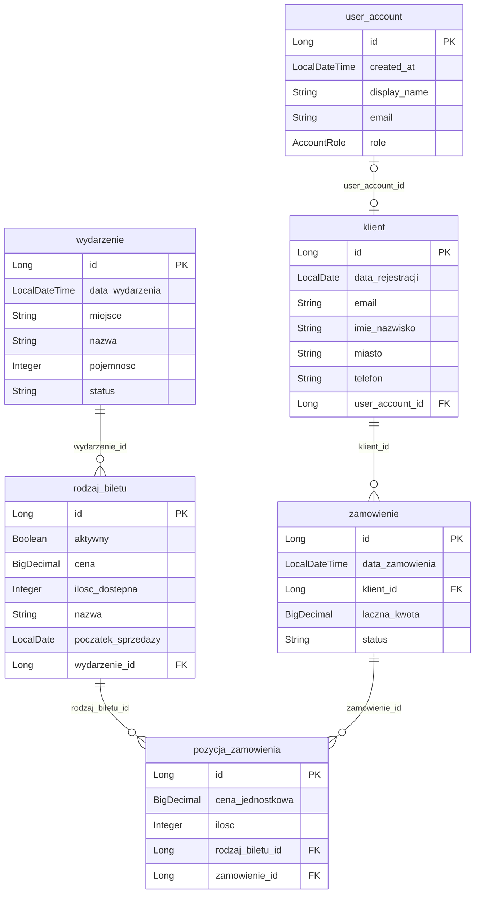

# Schemat bazy danych

Plik generują reguły projektu (panel Maven → Lifecycle → verify). Nie edytujcie go ręcznie.

Tabele: 6 · kolumny: 35 · relacje: 4 × @ManyToOne, 1 × @OneToMany, 1 × @OneToOne, 0 × @ManyToMany

| Tabela | Encja | Kolumny | Klucze obce |
|---|---|---|---|
| klient | Klient | 7 | user_account_id |
| pozycja_zamowienia | PozycjaZamowienia | 5 | rodzaj_biletu_id, zamowienie_id |
| rodzaj_biletu | RodzajBiletu | 7 | wydarzenie_id |
| user_account | UserAccount | 5 | — |
| wydarzenie | Wydarzenie | 6 | — |
| zamowienie | Zamowienie | 5 | klient_id |

